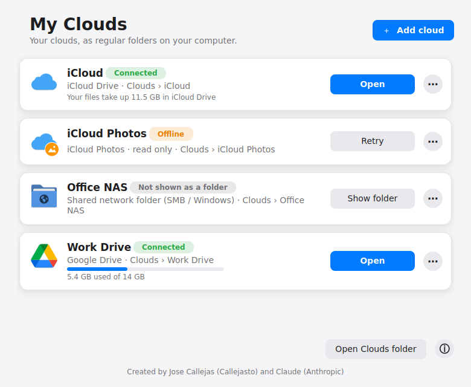
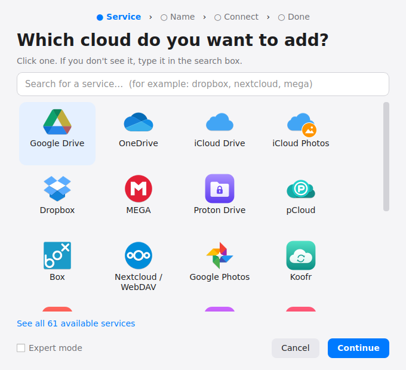

  

<h1 align="center">My Clouds (Mis nubes)</h1>

  Your clouds as regular folders on your computer, on Linux and Windows. 
  Google Drive, OneDrive, iCloud Drive, iCloud Photos, Dropbox, MEGA, Nextcloud and 60 more services.

  <a href="README.md">Español</a> · <b>English</b>

  

## Who is it for?

For people who **don't know how to use the terminal**. Everything happens in windows, with step-by-step explanations: choose your cloud, give it a name, sign in, done. Your files appear in the `Clouds` folder and open on their own every time you turn on your computer, just like on Windows or Mac.

## Installation

### On Windows

1. Download **`Mis nubes.exe`** from [**Releases**](../../releases/latest).
2. **Double-click** it. The first time it downloads two free programs it needs: **rclone** and **WinFsp** (about 30 MB). Windows will ask for permission to install WinFsp: press **"Yes"**.
3. Press **"Add cloud"** and follow the steps.

Each cloud can be shown **as a drive in "This PC"** (with its own letter, e.g. `G:`, recommended) or **as a folder** inside `Clouds`; you choose when adding it and can change it later from the ⋯ button on its card. After the first time, **My Clouds** is installed (you can delete the downloaded file), with shortcuts on the Desktop and in the Start menu, and it opens in the background when you turn on the computer: its icon next to the clock shows each cloud's status and lets you connect or disconnect it.

> **Requirements:** Windows 10 or 11 (64-bit). If Windows SmartScreen warns that the file is unknown, press "More info" › "Run anyway" (the program is not signed with a paid certificate).

### On Linux

1. Download **`Mis nubes.desktop`** from [**Releases**](../../releases/latest) (or from the [`dist`](dist) folder).
2. **Double-click** it. The first time, your system will ask whether you trust the file: choose **"Execute"** or **"Continue"**.
3. Type your computer password when asked (only the first time, to install what's needed).
4. Press **"Add cloud"** and follow the steps.

After the first time, **My Clouds** appears in your application menu with its icon.

> **Requirements:** CachyOS, Arch Linux or derivatives, with the **KDE Plasma** desktop. It weighs about 40 KB; everything else (rclone, PyQt6, Papirus icons) is installed automatically from the official repositories.

## What it does

  

- **More than 60 services:** Google Drive, Google Photos, OneDrive, iCloud Drive, iCloud Photos, Dropbox, MEGA, Proton Drive, pCloud, Box, Nextcloud/ownCloud (WebDAV), Windows shared folders (SMB), SFTP, FTP, Amazon S3 and compatible, Backblaze B2 and many more.
- **Several accounts** of the same service, each with **a name you choose** (for example, "Work Drive" and "Personal Drive").
- **They open on their own** when you turn on your computer.
- **Icon next to the clock:** each cloud's status, connect/disconnect without opening the window.
- **They don't take up space:** files are downloaded when you open them.
- **Used space** for each cloud (for services that allow it).
- **iCloud Photos online:** your photos by album, without copying them to your computer (read only).
- **Clear errors** explained in plain words.
- **Polished design** inspired by macOS, with light and dark mode.
- **"My Clouds" shortcut** in the side panel of the file manager (Dolphin).
- **In Spanish and English**, ready for more languages.
- **Updates itself:** when a new version is out, a notice appears with an “Update” button. The download is verified before installing and your clouds are not touched.

## Languages

The app uses your system language. You can also change it in **ⓘ › Language**.
It currently speaks **Spanish** and **English**. Want to translate it into another language? It's just a text file, no programming needed: follow the guide in [`idiomas/LEEME.md`](idiomas/LEEME.md).

## FAQ

**Does disconnecting a cloud delete anything?**
No. "Disconnect" only removes the folder from this computer. Your files stay in the cloud.

**Where are my passwords stored?**
In rclone's configuration on your own computer (`~/.config/rclone/rclone.conf`), a file only your user can open. rclone stores passwords *obscured* (not readable at a glance) but not encrypted: protect your computer session with a password. For Google, Microsoft, Dropbox and similar services, you type your password only on the service's official page, never in this app.

**iCloud asks me to sign in again.**
That's normal: Apple requires it every 30 days. Press **⋯ › Sign in again** on its card.

**Why is iCloud Photos read only?**
Apple doesn't allow uploading or deleting photos outside its own apps. Use your iPhone for that.

## For developers

- The whole program is in [`src/mis_nubes.py`](src/mis_nubes.py) (Python 3 + PyQt6). The code is written in Spanish; every visible text goes through `_()`.
- [`construir.sh`](construir.sh) builds `dist/Mis nubes.desktop`: a single-file launcher that carries the program inside, compressed.
- It is the same file for Linux and Windows: everything that differs is marked with `WINDOWS`.
- Each cloud is, on Linux, a systemd user service (`~/.config/systemd/user/mis-nubes-*.service`) and, on Windows, a Task Scheduler task (`Mis nubes\…`, defined in `%LOCALAPPDATA%\mis-nubes\tareas\*.xml`). Both run `rclone mount` at logon; on Windows through [WinFsp](https://winfsp.dev).
- [`construir-windows.py`](construir-windows.py) builds `dist/Mis nubes.exe` with PyInstaller (on Windows: `pip install PyQt6 pyinstaller` then `python construir-windows.py`). The [`.github/workflows/windows.yml`](.github/workflows/windows.yml) workflow does it automatically on GitHub.
- **Publishing a version:** change `VERSION` in the code, run `./construir.sh` and create a release tagged `vX.Y` (the same version) with `dist/Mis nubes.desktop` attached. When the tag is pushed, GitHub Actions builds `Mis nubes.exe` and attaches it to that same release. Installed copies (Linux and Windows) detect it, check its SHA-256 digest and update themselves.

## Credits

Created by **Jose Callejas** ([@Callejasto](https://github.com/Callejasto)) and **Claude** (Anthropic).

Powered by [rclone](https://rclone.org) (MIT license). On Linux, service icons come from the free [Papirus](https://github.com/PapirusDevelopmentTeam/papirus-icon-theme) theme (GPL-3.0), installed from your system repositories (on Windows, and on Linux without Papirus, the copies bundled in [`icons/papirus`](icons/papirus) are used, with their license); on Windows, clouds appear as folders thanks to [WinFsp](https://winfsp.dev) (GPLv3 with a free-software exception); brands and logos belong to their respective owners. The Proton Drive, Koofr, Amazon S3 and Backblaze B2 icons in the [`icons`](icons) folder are original designs made for this project, not their official logos. This project is not affiliated with Google, Microsoft, Apple or any other service.

## License

[MIT](LICENSE) © 2026 Jose Callejas (Callejasto)
