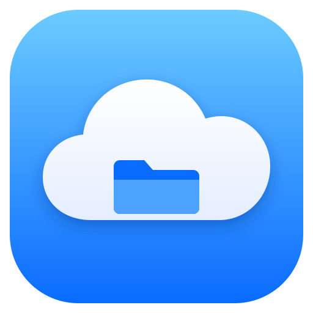
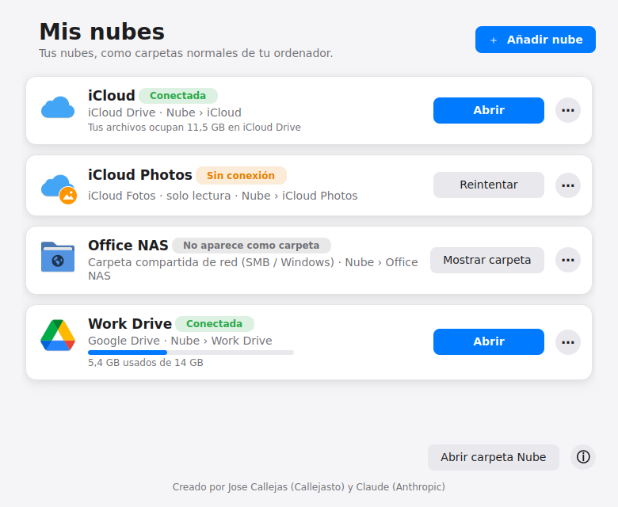
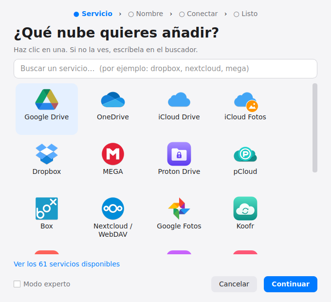
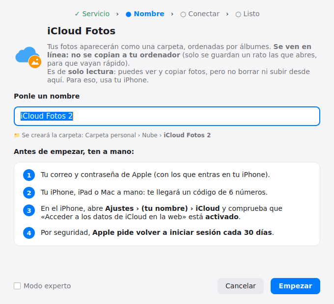

<p align="center">
  
</p>

<h1 align="center">Mis nubes</h1>

<p align="center">
  Tus nubes como carpetas normales de tu ordenador, en Linux.<br>
  Google Drive, OneDrive, iCloud Drive, iCloud Fotos, Dropbox, MEGA, Nextcloud y 60 servicios más.
</p>

<p align="center">
  <b>Español</b> · <a href="README.en.md">English</a>
</p>

<p align="center">
  
</p>

## ¿Para quién es?

Para personas que **no saben usar la terminal**. Todo se hace con ventanas, en español y con explicaciones paso a paso: eliges tu nube, le pones un nombre, inicias sesión y listo. Tus archivos aparecen en la carpeta `Nube` y se abren solos cada vez que enciendes el ordenador, igual que en Windows o en Mac.

## Instalación

1. Descarga el archivo **`Mis nubes.desktop`** desde la sección [**Releases**](../../releases/latest) (o desde la carpeta [`dist`](dist)).
2. Haz **doble clic** sobre él. La primera vez, el sistema te preguntará si confías en el archivo: elige **«Ejecutar»** o **«Continuar»**.
3. Escribe tu contraseña del ordenador cuando te la pida (solo la primera vez, para instalar lo necesario).
4. Pulsa **«Añadir nube»** y sigue los pasos.

Después de la primera vez, **Mis nubes** aparece en el menú de aplicaciones con su icono.

> **Requisitos:** CachyOS, Arch Linux o derivadas, con escritorio **KDE Plasma**. Ocupa unos 40 KB; lo demás (rclone, PyQt6, iconos Papirus) se instala solo desde los repositorios oficiales.

## Qué hace

<p align="center">
  
  
</p>

- **Más de 60 servicios:** Google Drive, Google Fotos, OneDrive, iCloud Drive, iCloud Fotos, Dropbox, MEGA, Proton Drive, pCloud, Box, Nextcloud/ownCloud (WebDAV), carpetas compartidas de Windows (SMB), SFTP, FTP, Amazon S3 y compatibles, Backblaze B2 y muchos más.
- **Varias cuentas** del mismo servicio, cada una con **el nombre que tú elijas** (por ejemplo, «Drive del trabajo» y «Drive personal»).
- **Se abren solas** al encender el ordenador.
- **No ocupan espacio:** los archivos se descargan cuando los abres.
- **Espacio usado** de cada nube (en los servicios que lo permiten).
- **iCloud Fotos en línea:** tus fotos por álbumes, sin copiarlas al ordenador (solo lectura).
- **Todo en español**, con los errores explicados en palabras sencillas.
- **Diseño cuidado** inspirado en macOS, con modo claro y oscuro.
- Atajo **«Mis nubes»** en el panel lateral del explorador de archivos (Dolphin).
- **En español e inglés**, y preparado para más idiomas (ver abajo).

## Idiomas

La aplicación usa el idioma de tu sistema. También puedes cambiarlo en **ⓘ › Idioma**.
Hoy está en **español** e **inglés**. ¿Quieres traducirla a otro idioma? Es solo un archivo de
texto, sin programar: sigue la guía en [`idiomas/LEEME.md`](idiomas/LEEME.md).

## Preguntas frecuentes

**¿Borra algo de mis nubes si desconecto una?**
No. «Desconectar» solo quita la carpeta de este ordenador. Tus archivos siguen en la nube.

**¿Dónde se guardan mis contraseñas?**
En la configuración de rclone de tu propio ordenador (`~/.config/rclone/rclone.conf`), cifradas. Para Google, Microsoft, Dropbox y similares, la contraseña se escribe solo en la página oficial del servicio, nunca en esta aplicación.

**iCloud me pide iniciar sesión otra vez.**
Es normal: Apple lo exige cada 30 días. Pulsa **⋯ › Volver a iniciar sesión** en su tarjeta.

**¿Por qué iCloud Fotos es de solo lectura?**
Apple no permite subir ni borrar fotos desde fuera de sus aplicaciones. Para eso, usa tu iPhone.

## Para desarrolladores

- El programa completo está en [`src/mis_nubes.py`](src/mis_nubes.py) (Python 3 + PyQt6).
- [`construir.sh`](construir.sh) genera `dist/Mis nubes.desktop`: un lanzador de un solo archivo que lleva el programa dentro, comprimido.
- Cada nube es un servicio de usuario de systemd (`~/.config/systemd/user/mis-nubes-*.service`) que ejecuta `rclone mount`.

```bash
./construir.sh                      # regenera dist/Mis nubes.desktop
python3 src/mis_nubes.py            # o ejecuta el programa directamente
```

## Créditos

Creado por **Jose Callejas** ([@Callejasto](https://github.com/Callejasto)) y **Claude** (Anthropic).

Funciona gracias a [rclone](https://rclone.org) (licencia MIT). Los iconos de los servicios provienen del tema libre [Papirus](https://github.com/PapirusDevelopmentTeam/papirus-icon-theme) (GPL-3.0), instalado desde los repositorios del sistema; las marcas y logotipos pertenecen a sus respectivos dueños. Los iconos de Proton Drive y Koofr de la carpeta [`icons`](icons) son diseños originales de este proyecto, no sus logotipos oficiales. Este proyecto no está afiliado a Google, Microsoft, Apple ni a ningún otro servicio.

## Licencia

[MIT](LICENSE) © 2026 Jose Callejas (Callejasto)
